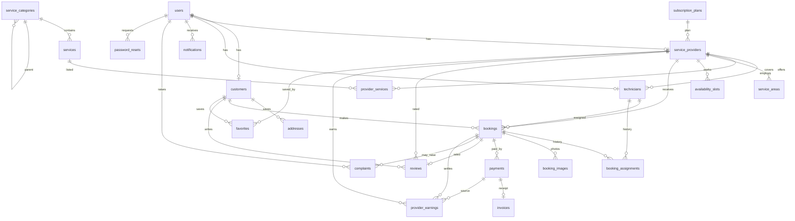

# Database schema and ER diagram

The written MySQL 8 script is `docs/schema.sql` (23 tables). SQLAlchemy creates the same tables on SQLite, MySQL, or Postgres from `backend/app/models.py`. The current public app uses MySQL 8. `render.yaml` is set up to use a free Render Postgres database when that blueprint is applied.

## Entity relationship diagram

## Tables

| Table | Purpose |
| --- | --- |
| users | Login identity, role, status, bcrypt password |
| customers | Customer profile linked to a user |
| service_providers | Business, verification, plan, rating, commission |
| technicians | Staff linked to one provider |
| subscription_plans | Starter 20%, Growth 15%, Scale 10% commission |
| addresses | Customer addresses |
| service_categories | Eight top-level categories plus two child categories |
| services | Catalog item, base price, duration |
| provider_services | A provider's price for a catalog service |
| service_areas | City and pincode the provider covers |
| availability_slots | Weekly working hours |
| bookings | Job, slot, money breakdown, status |
| booking_assignments | Technician assignment history |
| booking_images | Problem or completion photos |
| payments | Checkout attempt and result |
| invoices | Receipt created after a successful payment |
| coupons | WELCOME10, FLAT150, MONSOON20 |
| reviews | One review per booking, plus a provider reply |
| complaints | Customer complaint, optional booking link |
| notifications | In-app messages |
| provider_earnings | Gross, commission, and net after payment |
| favorites | Customer saves a provider |
| password_resets | Short-lived reset code |

## Booking rules stored in the database

- Status values: Pending, Confirmed, Provider Assigned, In Progress, Completed, Cancelled, Rejected.
- `slot_key` is unique. A second booking for the same provider, date, and time returns HTTP 409.
- Cancelled and rejected bookings clear `slot_key`, so the hour can be booked again.
- Money on a booking: subtotal, discount, taxable amount, GST at 18%, commission from the provider plan, provider earning, and total.
