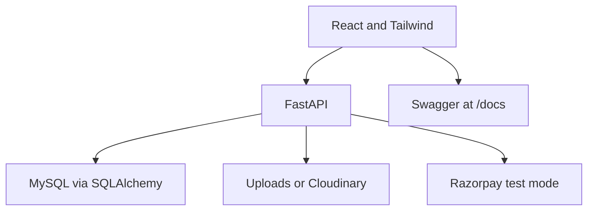

# Requirement analysis and planning

HomeServe Technologies wants one place where an Ahmedabad customer can book a verified electrician, plumber, AC technician, cleaner, painter, carpenter, appliance repair crew, or pest-control visit. The provider accepts the job, assigns a technician, and the platform keeps the payment, the review, and the complaint.

## Roles and permissions

| Role | May | May not |
| --- | --- | --- |
| Customer | Own profile, addresses, bookings, payments, reviews, complaints, favourites | Another customer's booking, admin stats |
| Provider | Own offers, hours, areas, technicians, assigned bookings | Another provider's jobs |
| Technician | Accept, arrive, complete, and photograph only assigned jobs | Unassigned jobs |
| Admin | Users, verification, catalog, coupons, plans, complaints, reports | Act as a customer without that role |

## Non-functional requirements

- Responsive pages for a phone and a laptop.
- Passwords hashed. JWT expires in 12 hours.
- One provider slot cannot be booked twice.
- API errors stay short and do not include a stack trace.
- Secrets stay in environment variables.
- The API is documented at `/docs`.

## Module list

1. Authentication and authorization
2. Customer management
3. Service categories and listings
4. Service provider management
5. Booking and appointments
6. Technician management
7. Payments, coupons, GST, invoices, refunds on cancel
8. In-app notifications
9. Ratings, reviews, and complaints
10. Analytics and CSV reports

## Business workflow

```mermaid
flowchart LR
  search[Customer searches] --> book[Books a free slot]
  book --> pending[Pending]
  pending --> accept[Provider accepts]
  accept --> assign[Assigns technician]
  assign --> job[Technician accepts]
  job --> arrive[Marks arrival]
  arrive --> done[Completes the job]
  done --> pay[Customer pays]
  pay --> review[Customer reviews]
```

## Project flow

## Roadmap that was followed

1. Requirements, stories, and this plan.
2. Role screens and the catalog.
3. Schema, ER diagram, and seed records.
4. REST API, JWT, and Swagger.
5. Connect the screens to the API.
6. Pytest, Postman, and Playwright.
7. Security checklist.
8. GitHub history, branches, and a pull request.
9. A public URL with the API and Swagger on the same host.

## Where the phase 1 files live

| Deliverable | File |
| --- | --- |
| Requirement specification | This file and `docs/REQUIREMENTS_TRACE.md` |
| User stories | `docs/USER_STORIES.md` |
| Project flow | Diagrams above |
| Module list | The numbered list above |
| Business workflow | The booking diagram above |
